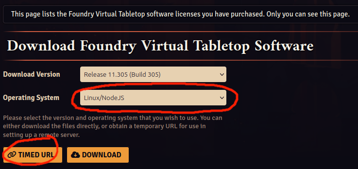

[](https://github.com/pgschk/foundryvtt-containerized/actions/workflows/container-publish.yml)

[](https://github.com/pgschk/foundryvtt-containerized/actions/workflows/trivy-schedule.yml)

# FoundryVTT Container

This project is not affiliated with [FoundryVTT](https://foundryvtt.com) and is a pure containerization project that provides a container capable of running [FoundryVTT](https://foundryvtt.com), but **it does not contain FoundryVTT!**

In order to start this container for the first time, you need to provide a timed download URL provided through your [FoundryVTT](https://foundryvtt.com) account. Visit https://foundryvtt.com/purchase/ to purchase a license key for this excellent software.


## What does it do?

This container provides the necessary [Node.js](https://nodejs.org/) environment for FoundryVTT, based on [Alpine Linux](https://alpinelinux.org/) and its Node.js package, for `linux/amd64` and `linux/arm64`. You will need to provide a valid timed download URL for FoundryVTT through the environment variable
`FOUNDRYVTT_DOWNLOAD_URL` as described in the examples when you first start the container. This will cause it to download FoundryVTT from that URL and store it. On subsequent launches you can remove this environment variable, or leave it, it does not cause problems.

Until FoundryVTT is installed, for example because the download URL is missing or has expired, the container serves a page with these instructions on the same port.

## Configuration

| Variable | Default | Purpose |
|---|---|---|
| `FOUNDRYVTT_DOWNLOAD_URL` | (none) | Timed download URL, only needed until FoundryVTT is installed. It is never printed to the logs. |
| `FOUNDRYVTT_INSTALL_PATH` | `/usr/src/app/foundryvtt` | Where FoundryVTT is installed. Mount a volume here. |
| `FOUNDRYVTT_DATA_PATH` | `/data/foundryvtt` | FoundryVTT's user data (worlds, systems, modules). Mount a volume here. |
| `FOUNDRYVTT_LISTEN_PORT` | `8080` | Port FoundryVTT (or the instructions page) listens on inside the container. |

The container runs as uid 1000. The install and data directories belong to uid 1000 and group 0, so it also runs with an arbitrary uid in group 0, as on OpenShift.

## Obtaining the TIMED DOWNLOAD URL

1. Make sure you have purchased a valid FoundryVTT license at https://foundryvtt.com/purchase/.
2. Log into your FoundryVTT.com account.
3. Visit https://foundryvtt.com/me/licenses.
4. On this page, set "Operating System" to "Linux/NodeJS"
5. Click the "TIMED URL" button. This copies a timed download URL to your clipboard.
6. Paste this URL as environment variable `FOUNDRYVTT_DOWNLOAD_URL` and start your container (see examples below)



## Examples

### Docker

```sh
mkdir install data && chown 1000 install data
docker run  --user 1000:1000 -p 8080:8080 -v ./data:/data/foundryvtt -v ./install:/usr/src/app/foundryvtt -e FOUNDRYVTT_DOWNLOAD_URL="<your-timed-download-url>" pgschk/foundryvtt-containerized:latest
```

Visit <http://localhost:8080/> to confirm the FoundryVTT Terms of Service and enter your license key.

### Docker Compose

Go to [examples/docker-compose](./examples/docker-compose/) and edit `.env` to set your timed download URL for FoundryVTT.

Afterwards run

```sh
docker compose up -d
```

Visit <http://localhost:8080/> to confirm the FoundryVTT Terms of Service and enter your license key.

### Kubernetes

- Review and adapt the example in [examples/kubernetes/deployment.yaml](./examples/kubernetes/deployment.yaml).
- Make sure to set your timed download URL for FoundryVTT as environment variable `FOUNDRYVTT_DOWNLOAD_URL`.
- Start your Kubernetes deployment:

```sh
kubectl apply -n <target namespace> -f examples/kubernetes/deployment.yaml
```

Or use the Helm chart at <https://github.com/pgschk/helm-charts/tree/main/charts/foundryvtt-containerized>

## Verifying the image

Images are signed with [cosign](https://github.com/sigstore/cosign) and carry an SBOM and build provenance:

```sh
cosign verify pgschk/foundryvtt-containerized:latest \
  --certificate-identity-regexp '^https://github.com/pgschk/foundryvtt-containerized/' \
  --certificate-oidc-issuer https://token.actions.githubusercontent.com
docker buildx imagetools inspect pgschk/foundryvtt-containerized:latest --format '{{ json .SBOM }}'
docker buildx imagetools inspect pgschk/foundryvtt-containerized:latest --format '{{ json .Provenance }}'
```
